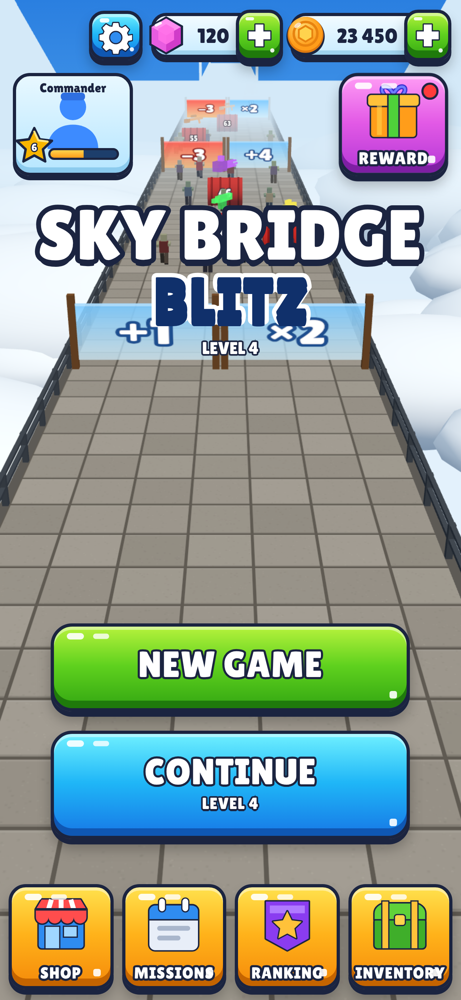
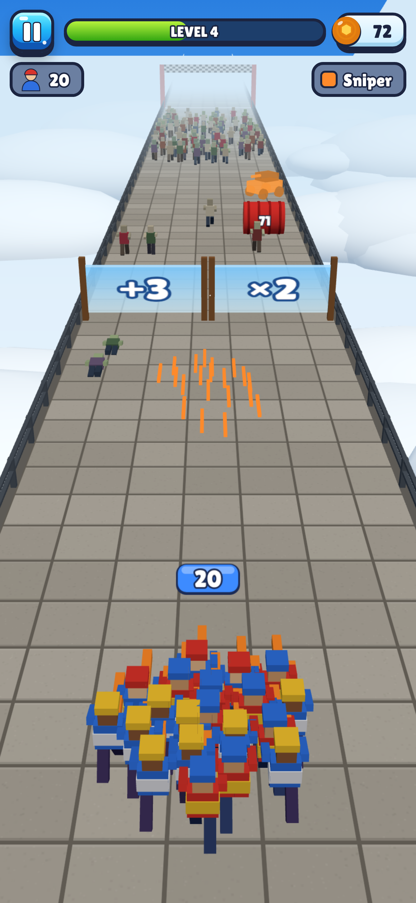
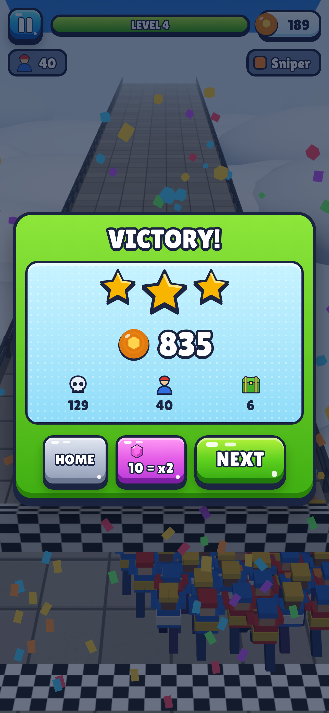

# Sky Bridge Blitz

A 3D mobile runner-shooter: lead a squad down a stone bridge above the clouds, shoot red barrels to grab the weapon on top, run through the blue **+ / ×** gates to grow your squad and dodge the red **−** gates. A huge zombie horde waits at the end of every level.

Built with **Three.js** (3D), **Vite** (bundling) and **Capacitor 8** (native iOS and Android shell). It runs as one codebase on iPhone, iPad, Android and the web.

| Menu | Gameplay | Victory |
|---|---|---|
|  |  |  |

## Features

- **Core loop:** auto-firing squad, drag left and right to steer, barrels with HP counters that drop weapons, gates you can shoot to raise their value, and a final horde.
- **7 weapons plus a vehicle:** Pistol, SMG, Assault Rifle, Gatling, Sniper (pierces), Plasma Blaster, Field Cannon (splash), and an Armored Car ally with its own turret.
- **Endless levels:** generated per level with a tuned difficulty curve. Levels 1–5 can be won with no upgrades; later levels need upgrades.
- **Meta game:** coins, gems, 4 upgrade tracks, a weapon collection log, daily missions, a 7-day daily reward, player rank/XP, a weekly league against AI rivals, revive, and ×2 rewards.
- **Shop:** coin and diamond packs as real in-app purchases (StoreKit / Google Play Billing through `cordova-plugin-purchase`).
- **Polish:** procedural sound effects and music (no audio files), haptics, confetti, a golden pickup beam, explosions, a swipe tutorial, and safe-area support for notches and the home indicator.
- **Saving:** progress is stored on the device.

## Run it

```bash
cd mobile-game
npm install
npm run dev        # http://localhost:5173, open with phone emulation in devtools
```

Controls on desktop: drag with the mouse, or use the ← → / A D keys.

## Ship to the App Store

You need a Mac with **Xcode 16+** and a paid **Apple Developer** account ($99/yr).

1. **Build and open in Xcode**
   ```bash
   npm install
   npm run ios          # vite build → cap sync ios → opens Xcode
   ```
2. **Set your bundle ID and team.** In Xcode, open *App target → Signing & Capabilities*: pick your Team and set a unique Bundle Identifier. Change `appId` in `capacitor.config.json` to the same value. Add the **In-App Purchase** capability.
3. **Create the app** in [App Store Connect](https://appstoreconnect.apple.com) with that bundle ID.
4. **Create the in-app purchases** (*Monetization → In-App Purchases*). All are **Consumable**, and the Product IDs must match `src/services/store.js` exactly:

   | Product ID | Gives | Price |
   |---|---|---|
   | `coins_10k` | 10,000 coins | $0.99 |
   | `coins_30k` | 30,000 coins | $1.99 |
   | `coins_50k` | 50,000 coins | $3.99 |
   | `coins_100k` | 100,000 coins | $4.99 |
   | `gems_100` | 100 gems | $0.99 |
   | `gems_550` | 550 gems | $4.99 |
   | `gems_1200` | 1,200 gems | $9.99 |
   | `gems_2500` | 2,500 gems | $19.99 |

   Prices shown in-game come from the App Store at runtime, so they are localized automatically.
5. **Store listing.** Upload the screenshots in `store-assets/` (1290×2796, the 6.7" iPhone size) and `store-assets/app-icon-1024.png`. Suggested settings:
   - Category: Games → Action / Casual
   - Age rating: *Infrequent/Mild Cartoon or Fantasy Violence*
   - App Privacy: *Data Not Collected*. The game has no accounts, analytics or ads, and saves locally.
   - A privacy policy URL is required. A one-page site stating that no data is collected is enough.
6. **Upload.** In Xcode, use *Product → Archive → Distribute App → App Store Connect*. Test with TestFlight (sandbox purchases), then submit for review.

Android follows the same idea: run `npm run android`, which opens Android Studio. Create the same product IDs in Google Play Console as consumable in-app products.

## Project layout

```
src/
  main.js              app controller: menu, HUD, shop, missions, ranking, inventory, results
  styles.css           casual game UI pack style (chunky outlined buttons, glossy highlights)
  ui/icons.js          SVG icons (coin, gem, gear, shop, missions, ranking, inventory…)
  game/Game.js         3D game: squad, bullets/auto-aim, zombies, barrels, gates, pickups, camera
  game/level.js        seeded level generator + difficulty curve
  game/weapons.js      weapon stats (damage, fire rate, pierce, splash, colors)
  game/crowd.js        instanced low-poly characters (hundreds of zombies at 60fps)
  game/models.js       bridge, barrels, gates, weapon holograms, armored car, scenery
  game/fx.js           particles, flashes, golden pickup beam
  services/store.js    in-app purchases (native) / test purchases (web preview)
  services/save.js     save data, upgrade costs
  services/audio.js    procedural SFX + music
  services/haptics.js  Capacitor haptics
ios/  android/         native Capacitor projects (icons + splash already generated)
assets/                source icon/splash art (regenerate with `npx capacitor-assets generate`)
store-assets/          App Store screenshots + 1024 icon
```

## Tuning

- Difficulty: `src/game/level.js` sets zombie HP, pack sizes, barrel HP, gate values and the size of the final horde.
- Weapons: `src/game/weapons.js`.
- Economy: `UPGRADES` in `src/services/save.js`, and level rewards in `endRun()` in `src/main.js`.
- Starting coins and gems: `DEFAULT` in `src/services/save.js`.

## Notes

- In the web preview, the shop runs **test purchases** that are free and labelled as such. On a device, purchases go through Apple and Google.
- The ranking is a weekly league against AI rivals, and the screen says so. Game Center leaderboards would be a natural next addition.
- All art, characters, names and sounds are original. They are made from code, with no third-party game assets.
